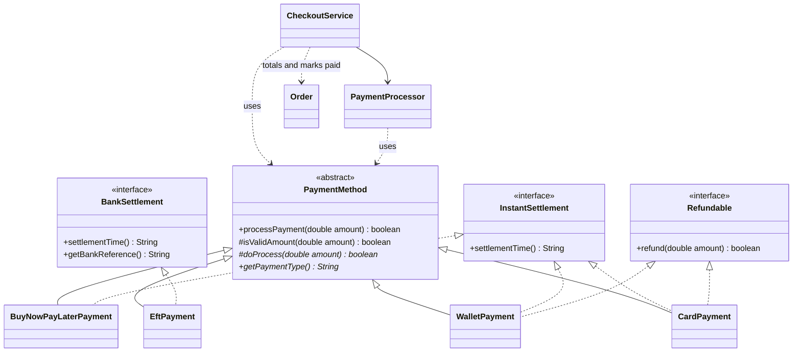

# PayNest: Merchant Order Desk and Unified Checkout
A commerce system built in plain Java 21 with Maven.

- Mercehant order desk built the merchant order desk: customers, products, orders and a printed invoice.
-Unified checkout adds a unified checkout: one checkout path that accepts any payment rail (card, EFT, in-app wallet and buy-now-pay-later). The order total is the same for every rail; only the way the customer pays changes.

## Requirements

- Java 21 
- Maven 3.9 or newer 

## How to run

Clone the repository and go into the project folder:

```bash
git clone https://github.com/Umuzi-skillslab/merchant-order-desk-and-catalogue-engine-Tshifhiwa13.git
```
Run the demo (pays with CARD by default):

```bash
cd paynestsystem
mvn clean test  
mvn compile exec:java
```
Tests expected result:

```text
Tests run: 32, Failures: 0, Errors: 0, Skipped: 0
BUILD SUCCESS
```
### Choosing a payment rail for the demo:
Windows PowerShell:

```powershell
mvn compile exec:java "-Dexec.args=eft"
mvn compile exec:java "-Dexec.args=wallet"
mvn compile exec:java "-Dexec.args=bnpl"
mvn compile exec:java "-Dexec.args=wallet-low"
```

Git Bash, macOS or Linux:

```bash
mvn compile exec:java -Dexec.args="eft"
mvn compile exec:java -Dexec.args="wallet"
mvn compile exec:java -Dexec.args="bnpl"
mvn compile exec:java -Dexec.args="wallet-low"
```

| Option | What it shows |
|---|---|
| `card` (default) | Card payment, settles immediately |
| `eft` | Bank transfer, settles in 1-2 business days, with a bank reference |
| `wallet` | In-app wallet payment from a R50 000 balance |
| `bnpl` | Buy now, pay later in 4 instalments |
| `wallet-low` | Wallet with only R500: the payment is declined and the order stays open |

## Expected output (`mvn compile exec:java`)

```text
=======================================
************* PAYMENT INVOICE *********
=======================================
Order ID: 35
Customer: Tshifhiwa Makherana
Email: Fifi@example.org
Status: OPEN
=======================================
Product              Qty        Subtotal
=======================================
Hammer               1          150,00
Electric Drill       1          2000,00
Box of Nails         3          360,00
=======================================
Total Amount:                   2510,00
=======================================

=======================================
************* CHECKOUT ****************
=======================================
Order ID: 35
Amount due: R2510,00
Payment rail: CARD
---------------------------------------
Processing payment via CARD...
[CARD] Authorising card payment of R2510,00
Payment successful via CARD
Amount: R2510,00
Settles: immediate
---------------------------------------
Order #35 completed: R2510,00 paid via CARD. Status: PAID
=======================================
```

With `wallet-low`, the checkout ends with:

```text
[WALLET] Declined: balance R500,00 is lower than R2510,00
Payment failed via WALLET
---------------------------------------
Order #35 NOT completed: payment via WALLET failed. Status: OPEN
```

## Why a payment abstraction beats one big method

One `pay(order, type)` method full of `if card / else if EFT / else if wallet` puts every rail's rules in one place. That method must be edited, re-tested and re-reviewed every time the business adds a rail, and it repeats validation, logging and failure handling in every branch. With the `PaymentMethod` abstraction, checkout depends on one contract: charge this Rand amount, say whether it worked, and give a label. Each rail keeps its own behaviour in its own class. Shared rules, such as rejecting zero or negative amounts, are written once in the parent class, so no rail can skip them. Adding a rail becomes adding a class, not changing code that already handles real money, and each rail can be tested on its own.

## Design



| Package | Responsibility |
|---|---|
| `domain` | `Customer`, `Product`, `OrderItem`, `Order` and `OrderStatus`. Business rules only: no console output and no knowledge of payment rails. |
| `payment` | `PaymentMethod` (parent class), the three capability interfaces, the four rails and `PaymentProcessor`. |
| `service` | `OrderService`, `OrderSummary` (prints the invoice) and `CheckoutService` (the single checkout path). |
| `util` | `RandFormat`: formats Rand amounts the same way everywhere, so the invoice and the checkout match. |
| `app` | `PayNestApplication`: builds the order and wires everything together. It is the only class that names concrete rails. |

### How checkout works

`CheckoutService.checkout(order, paymentMethod)`:

1. Rejects an empty order or an order that is already paid.
2. Calculates the total once with `order.calculateTotal()`.
3. Passes exactly that amount to the chosen rail through `PaymentProcessor`.
4. Marks the order `PAID` only if the rail reports success. A declined payment leaves it `OPEN` so the customer can try another rail.

It accepts the `PaymentMethod` type and has no `if` or `switch` on the payment type.

### Parent class plus capability interfaces

Following the updated course design, `PaymentMethod` is an abstract class rather than an interface. Its `processPayment` method is `final`: it always runs the shared amount check first, then calls the rail's own `doProcess`. Interfaces group the rails by what they can do:

- `InstantSettlement`: the merchant is paid immediately (card, wallet, BNPL).
- `BankSettlement`: settles through the bank in 1-2 business days and has a bank reference (EFT).
- `Refundable`: money can be sent back (card, wallet). EFT is deliberately not refundable, because an EFT refund is a new bank transfer that operations would start, not a reversal.

`PaymentProcessor` checks the settlement group only to describe it in the console output. It never changes how a payment is processed.

## Adding a new rail: 

`BuyNowPayLaterPayment` was added to prove the design. It needed:

1. **One new file:** `payment/BuyNowPayLaterPayment.java`
2. **One line of wiring** in `PayNestApplication`: `rails.put("bnpl", BuyNowPayLaterPayment::new);`

`Order`, `CheckoutService` and `PaymentProcessor` did not change. The tests also include `RecordingPayment`, a rail that exists only in the test folder, which works with checkout without touching any production code.

## Business rules and assumptions

- **The amount charged equals the order total.** Checkout charges exactly the figure from `calculateTotal()`. A test confirms this, including for prices with cents.
- **Money is `BigDecimal` in the order.** The payment contract keeps the starter signature `processPayment(double amount)`. The total is rounded to cents and converted to `double` once, when it is handed to the rail. No calculations are done on the `double`.
- **Rounding.** Line subtotals are exact. The grand total is rounded once to 2 decimals (half-up). Example: 3 x R0,10 + 1 x R0,005 = R0,305, charged as R0,31.
- **Stable labels** for logs and receipts: `CARD`, `EFT`, `WALLET`, `BNPL`.
- **Success or failure** is the `true`/`false` returned by `processPayment`, as in the starter code.
- **Simulated rails:**
  - Card and EFT always approve.
  - The wallet declines when its balance is too low, and the balance stays unchanged.
  - BNPL declines totals above R20 000 and splits approved totals into 4 instalments.
- **Order lifecycle.** An empty order cannot be checked out. A paid order is locked: no more items can be added and it cannot be charged twice.

## Capstone 1 feedback addressed

| Feedback | What changed |
|---|---|
| Tighten immutability on `Order` | All fields are `final`, items can only be read through an unmodifiable list, and a paid order is locked. |
| Inject and decouple presentation from services | `OrderService` receives its `OrderSummary` and `CheckoutService` receives its `PaymentProcessor` through their constructors. `Order` prints nothing. Everything is wired in `PayNestApplication`. |
| More edge-case tests (empty order, decimal rounding) | New tests for an empty order's total, checking out and paying an empty order, decimal rounding, and charging the rounded total. |
| Explain how the design supports future change | The design and "Adding a new rail" sections above. |

## Tests

| Test class | What it covers |
|---|---|
| `OrderItemTest` | Line totals, invalid quantity and missing product. |
| `OrderTest` | Totals, empty order, rounding, read-only items, OPEN/PAID status and locking, invoice output. |
| `PaymentMethodTest` | The brief's sample test, labels, shared validation on every rail, wallet balance and refunds, EFT reference, BNPL limit, capability groups. |
| `PaymentProcessorTest` | Success and failure console messages, settlement description, missing payment method. |
| `CheckoutServiceTest` | The same order paid with all four rails, amount charged equals the order total, declined payment and retry, empty order, paying twice, missing inputs. |

## Project structure

```text
paynestsystem
├── pom.xml
├── README.md
└── src
    ├── main/java/com/paynestsystem
    │   ├── app
    │   │   └── PayNestApplication.java
    │   ├── domain
    │   │   ├── Customer.java
    │   │   ├── Order.java
    │   │   ├── OrderItem.java
    │   │   ├── OrderStatus.java
    │   │   └── Product.java
    │   ├── payment
    │   │   ├── PaymentMethod.java
    │   │   ├── InstantSettlement.java
    │   │   ├── BankSettlement.java
    │   │   ├── Refundable.java
    │   │   ├── CardPayment.java
    │   │   ├── EftPayment.java
    │   │   ├── WalletPayment.java
    │   │   ├── BuyNowPayLaterPayment.java
    │   │   └── PaymentProcessor.java
    │   ├── service
    │   │   ├── CheckoutService.java
    │   │   ├── OrderService.java
    │   │   └── OrderSummary.java
    │   └── util
    │       └── RandFormat.java
    └── test/java/com/paynestsystem
        ├── domain
        │   ├── OrderItemTest.java
        │   └── OrderTest.java
        ├── payment
        │   ├── PaymentMethodTest.java
        │   └── PaymentProcessorTest.java
        └── service
            ├── CheckoutServiceTest.java
            └── RecordingPayment.java
```

## Author

Tshifhiwa Makherana
